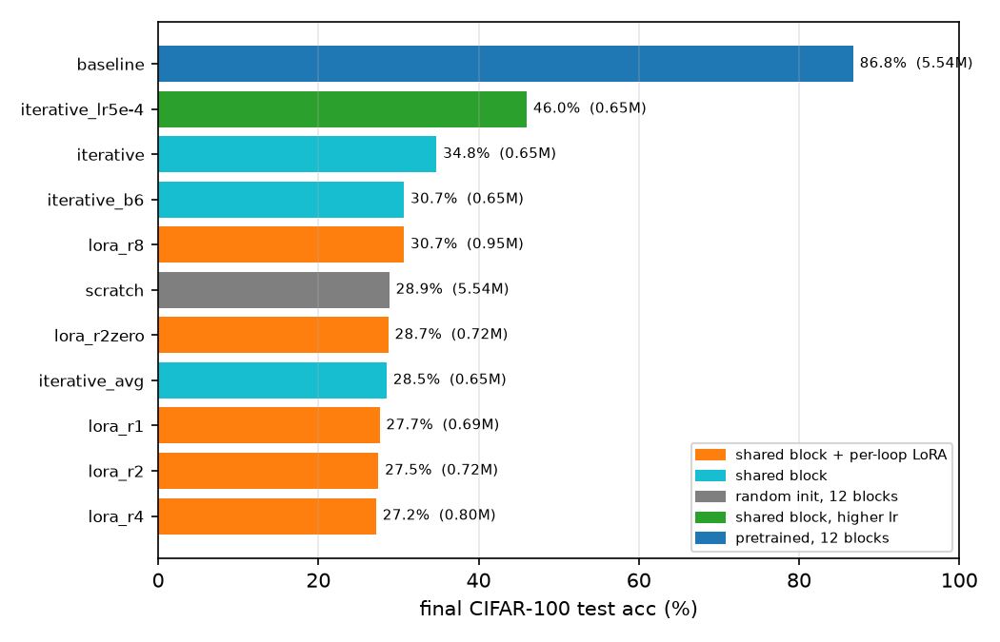
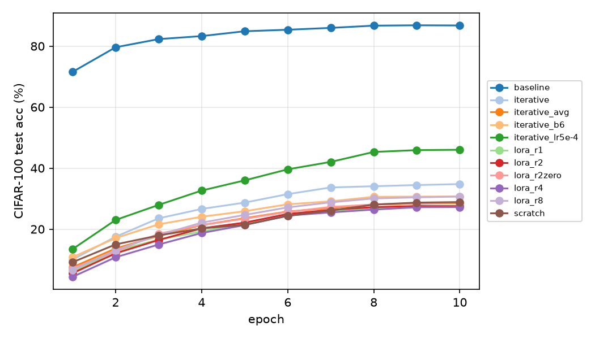
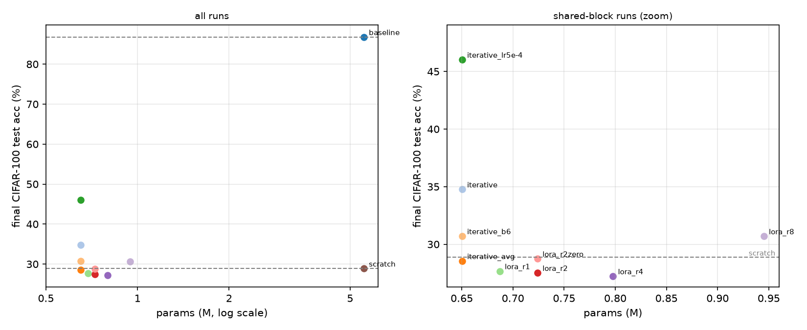

# Iterative ViT-Tiny: does reusing one transformer block work?

[](https://colab.research.google.com/github/reddy-nithin/Iterative-Transformers/blob/main/notebooks/colab_walkthrough.ipynb)

First test of the "iterative transformer" idea, requested by my supervisor. Not a paper: a quick, clean experiment.

**Question.** Take pretrained ViT-Tiny (12 transformer blocks), keep **one** block and apply that same block 12 times. How much accuracy do we lose in exchange for fewer parameters?

**Short answer.** Parameters drop by 88% (5.54 M to 0.65 M) but CIFAR-100 accuracy falls from 86.8% to 34.8% (block 0) or 30.7% (block 6). Compute and speed do not change. Round 2 found that the learning rate is the biggest lever: raising it from 1e-4 to 5e-4 lifts the shared model to 46.0%. Adding a small per-loop LoRA update did not help yet at the low learning rate. See [Round 2](#round-2-scratch-control-avg-init-lr-and-per-loop-lora).



## Round 1 results (CIFAR-100, 10 epochs, seed 0, RTX A4000)

| Model | Params | GFLOPs / img | Throughput (img/s) | Final test acc | Best test acc |
|---|---|---|---|---|---|
| Baseline (12 different blocks) | 5.544 M | 2.51 | 5653 | **86.77%** | 86.83% |
| Iterative, block 0 x 12 | 0.650 M | 2.51 | 5773 | 34.76% | 34.76% |
| Iterative, block 6 x 12 | 0.650 M | 2.51 | 5820 | 30.70% | 30.70% |

Per-epoch test accuracy (%):

| Epoch | 1 | 2 | 3 | 4 | 5 | 6 | 7 | 8 | 9 | 10 |
|---|---|---|---|---|---|---|---|---|---|---|
| Baseline | 71.5 | 79.6 | 82.3 | 83.3 | 84.9 | 85.4 | 86.0 | 86.7 | 86.8 | 86.8 |
| Block 0 x 12 | 10.0 | 17.5 | 23.5 | 26.6 | 28.7 | 31.5 | 33.7 | 34.1 | 34.5 | 34.8 |
| Block 6 x 12 | 10.8 | 17.1 | 21.6 | 24.1 | 25.9 | 28.1 | 29.1 | 30.6 | 30.6 | 30.7 |

Raw numbers: [docs/results/](docs/results/) (`baseline.json`, `iterative.json`, `iterative_b6.json`, `summary.md`).

## What the results mean

- **Size vs accuracy.** One shared block holds 444,864 parameters instead of 12 x 444,864. The model shrinks to 0.65 M (embeddings, norm and the 100-class head are the rest).
- **No compute saving.** FLOPs are identical, because the block still runs 12 times. Throughput differences (about 2%) are noise. Sharing saves memory and storage, not time.
- **Block choice did not rescue it.** I expected a middle block (6) to beat block 0, since block 0 does low-level patch mixing. It did worse (30.7% vs 34.8%). One seed and 10 epochs cannot rank the two blocks, but neither is close to the baseline.
- **Not converged.** Both iterative models were still rising slowly at epoch 10. The recipe (lr 1e-4) was set for fine-tuning a normal network, so it may be wrong for a shared block that must be re-learned.

## Round 2: scratch control, avg init, lr, and per-loop LoRA

Round 1 left two questions open. Is the shared model learning badly, or has it only lost the pretraining? And can a small per-loop update give each loop back some freedom? Round 2 adds:

- **scratch:** the same 12-block ViT-Tiny with random weights. This is the "zeroed weights" control (truly all-zero weights cannot train, because every unit would get the same gradient).
- **avg init** (`--init avg`): the shared block starts as the mean of all 12 pretrained blocks.
- **lr probe:** block 0 shared, lr 5e-4 instead of 1e-4.
- **per-loop LoRA** (`--model lora --rank r`): loop `i` uses `W_shared + B_i A_i` on the four big linears (qkv, proj, fc1, fc2). By default the shared block is the avg block and each `B_i A_i` starts as the best rank-r fit of (original block i minus shared block), found by SVD. `--lora-init zero` starts it at zero instead. This follows Relaxed Recursive Transformers (Bae et al., ICLR 2025, [arXiv 2410.20672](https://arxiv.org/abs/2410.20672)), which did it for language models. Code: [src/lora_loop.py](src/lora_loop.py).

```
plain shared block                 shared block + per-loop LoRA
x -> [W] -> [W] -> ... -> [W]      x -> [W + B0A0] -> [W + B1A1] -> ... -> [W + B11A11]
     one W, used 12 times               one W plus 12 tiny rank-r updates (r=2: +74K params)
```

Same recipe as round 1 unless noted (lr 1e-4, 10 epochs, seed 0).

| Model | Params | Final test acc |
|---|---|---|
| Baseline (pretrained, 12 blocks) | 5.544 M | **86.77%** |
| Scratch (random init, 12 blocks) | 5.544 M | 28.87% |
| Shared, block 0 | 0.650 M | 34.76% |
| Shared, block 0, **lr 5e-4** | 0.650 M | **46.02%** |
| Shared, block 6 | 0.650 M | 30.70% |
| Shared, avg init | 0.650 M | 28.54% |
| LoRA r=1 (avg + SVD) | 0.687 M | 27.66% |
| LoRA r=2 (avg + SVD) | 0.724 M | 27.51% |
| LoRA r=4 (avg + SVD) | 0.798 M | 27.22% |
| LoRA r=8 (avg + SVD) | 0.945 M | 30.69% |
| LoRA r=2 (avg + zero init) | 0.724 M | 28.74% |





What it means (one seed, so gaps under about 2 points are ties):

- **The learning rate matters more than anything else we changed.** The same block 0 model went from 34.8% to 46.0% at lr 5e-4. lr 1e-4 is a fine-tuning rate, and a shared block has to re-learn most of its job.
- **At lr 1e-4 the shared models sit near scratch level.** Little of the pretraining survives the sharing. The 0.65 M shared model still beats the 5.5 M scratch model (34.8% vs 28.9%), but scratch also ran at the low lr, so that comparison is not fair yet.
- **Per-loop LoRA has not helped yet.** Ranks 1 to 4 tie with the plain avg-init model (its fair comparison), and rank 8 is about 2 points better. The LoRA factors are tiny and were trained at lr 1e-4, roughly 10x below the usual LoRA rate, so they barely moved.
- **Avg init and SVD init did not transfer from the language-model paper.** Avg init was worse than block 0, and SVD init was no better than zero init. One likely reason: biases, LayerNorms and layer-scale are still shared, so even a full-rank SVD cannot rebuild the original network.

## Setup

- **Models.** `timm` `vit_tiny_patch16_224`, pretrained, new 100-class head. Iterative variant: `model.blocks = nn.Sequential(*[block] * 12)`, so the 12 slots are the same Python object and `.parameters()` counts it once ([src/models.py](src/models.py)).
- **Data.** `timm.data.create_dataset('torch/cifar100')`, resized to 224, transforms and normalization from the model's pretrained config ([src/data.py](src/data.py)).
- **Recipe (identical for all runs).** AdamW, lr 1e-4, weight decay 0.05, 1 warmup epoch then cosine decay, label smoothing 0.1, batch 128, 10 epochs, seed 0, mixed precision on GPU ([src/train.py](src/train.py)).
- **Metrics.** Unique parameters, forward GFLOPs per image (`torch.utils.flop_counter`, 1 MAC = 2 FLOPs), inference throughput at batch 256 ([src/metrics.py](src/metrics.py)).
- **Sharing proof.** [tests/test_sharing.py](tests/test_sharing.py): same object id, parameter count drops by exactly 11 x 444,864, gradients reach the one block, output shape is correct.

## Repo layout

```
src/models.py        baseline, scratch, iterative (block or avg init), lora builders
src/lora_loop.py     shared block + per-loop LoRA (SVD or zero init)
src/data.py          CIFAR-100 loaders via timm
src/metrics.py       params, FLOPs, throughput
src/train.py         one script, --model {baseline,scratch,iterative,lora} --init --rank --lora-init --tag
scripts/inspect_model.py   print blocks and params per block
scripts/compare.py         results table + 3 plots (per epoch, acc vs params, final-acc bars)
tests/test_sharing.py      weight-sharing checks
tests/test_lora_loop.py    LoRA param counts, gradients, init correctness
docs/results/              saved results from the server runs
LEARNING_LOG.md            notes and gotchas
```

## Reproduce

Setup (Mac or Linux server):
```
python3 -m venv .venv && source .venv/bin/activate
pip install -r requirements.txt
python -m pytest -q tests
```

Smoke test (CPU is fine, about 1 minute): `python -m src.train --model iterative --epochs 1 --subset 128 --batch-size 32 --num-workers 0 --tag _smoke`

Real runs (GPU server, inside tmux, check `nvidia-smi` first):
```
mkdir -p results
CUDA_VISIBLE_DEVICES=0 python -m src.train --model baseline  2>&1 | tee results/baseline.log
CUDA_VISIBLE_DEVICES=1 python -m src.train --model iterative 2>&1 | tee results/iterative.log
CUDA_VISIBLE_DEVICES=2 python -m src.train --model iterative --block-idx 6 --tag _b6 2>&1 | tee results/iterative_b6.log
python -m scripts.compare
```
Round 2 runs (same pattern, one GPU per job):
```
python -m src.train --model scratch
python -m src.train --model iterative --init avg --tag _avg
python -m src.train --model iterative --lr 5e-4 --tag _lr5e-4
python -m src.train --model lora --rank 2 --tag _r2          # also --rank 1 / 4 / 8
python -m src.train --model lora --rank 2 --lora-init zero --tag _r2zero
```
Each run takes about 8 minutes on one A4000. A 10-epoch run on an M2 Air CPU would take roughly 3 to 4 hours (estimate from a smoke test, not measured end to end).

## Gotchas learned

- `[block] * 12` shares one object; `copy.deepcopy` would silently make 12 independent blocks. The test guards this.
- Git does not store empty folders, so `results/` is kept with a `.gitkeep`. Result files are gitignored; the copies worth keeping live in `docs/results/`.
- FLOP counts differ between CPU (2.15 G) and GPU (2.51 G) because the attention op is counted differently. Compare models only on the same machine.
- On a private GitHub repo, `git clone` on the server needs a token; passwords are rejected.
- Run long jobs in `tmux`, one session per job, and name them distinctly (a duplicate name attaches to the old session instead of creating a new one).

## Limits and next steps

Limits: one seed, 10 epochs, nothing converged, CIFAR-100 only, and every round 2 comparison is confounded by the low learning rate.

Next:
1. Rerun scratch, block 0 and LoRA r=2 / r=8 (built on block 0) at lr 5e-4 and 1e-3.
2. Give the LoRA factors their own, roughly 10x higher learning rate.
3. Train for 30 epochs and repeat the best two over 2 seeds.
4. Add per-loop LayerNorm and bias, then try generating each loop's update from the loop index, f(i).
5. Sweep all 12 block indices with `--block-idx N`.
