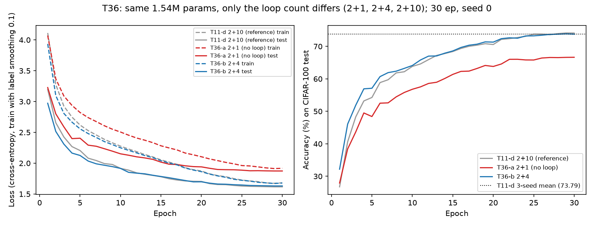

# T36 · Is looping worth it? Train 2+1 (no loop) and 2+4 (4 loops), compare with 2+10

From: planning session 2026-11-16 (Fable review)
Notion: https://notion.so/41a38c734705815a98d6d8cd7645cc2e

## Goal
Two training runs that differ from T11-d (2+10: B0, B1, then B2 x10) ONLY in how many times B2 is applied, during
training and at test. Same parameters (1,539,940) in all three.
- T36-a (2+1) says what loops 2..10 buy over a single pass with the same parameters.
- T36-b (2+4) says whether 4 loops trained as 4 match 10 loops (T13 and T31 suggest the model answers by loop 4).

## Runs
Recipe identical to T11-d: pretrained timm `vit_tiny_patch16_224`, CIFAR-100 224 px, AdamW lr 5e-4 all params,
wd 0.05, 1 warmup epoch + cosine over 30 epochs, label smoothing 0.1, batch 128, AMP, seed 0, loss at the last loop
only, nothing frozen.

| Run | Layout | Flags | Checkpoint |
|---|---|---|---|
| T11-d (reference) | 2+10 | `--model unroll --unique-blocks 3` | `T11-d_unroll_n3_30ep.pt` |
| T36-a | 2+1 (no loop) | `--model unroll --unique-blocks 3 --body-loops 1` | `T36-a_2p1_noloop_30ep.pt` |
| T36-b | 2+4 | `--model unroll --unique-blocks 3 --body-loops 4` | `T36-b_2p4_30ep.pt` |

    CUDA_VISIBLE_DEVICES=N SMOKE=1 bash tasks/T36_truncation_controls/run.sh T36-a   # 1 epoch, --subset 512
    CUDA_VISIBLE_DEVICES=N bash tasks/T36_truncation_controls/run.sh T36-a           # full run

New flag `--body-loops N` (src.train, src.models.build_unrolled): apply the repeated block N times. Default (not set)
= 12 - unique_blocks + 1, i.e. exactly the old behaviour for every `--unique-blocks` (10 for n = 3). The task text says
"default 10"; that is only true for n = 3, so the default is "as before" instead. Test:
`PYTHONPATH=. .venv/bin/python -m pytest tasks/T36_truncation_controls -q` (default = old layout logits within 1e-5;
N = 4 calls B2 exactly 4 times; params 1,539,940 for N = 1, 4, 10).

Note: 2+1 has no repeated block, so per-loop tools (`src.per_loop_readout.split_loop`, `--readout-loss`,
`--random-loops`, T34/T35-style analyses) do not apply to T36-a; `src.train` rejects those combinations.

## Decision rules (fixed in advance)
- T36-b within 0.8 pt of 73.79 (T11-d 3-seed mean): "2+4 matches 2+10 at about half the FLOPs (needs seeds before we
  switch the default; Nithin decides with Dr. Uddin)". More than 2 pt below: "late loops matter when trained for".
  Between: "unclear, run seeds".
- "Looping adds X pt over a single pass at equal parameters" with X = 73.79 - T36-a.
- Seed spread is 0.3 to 0.8 pt (T15): a one-seed difference under 0.8 pt is not an effect.

## Predictions (written before running)
T36-a 55 to 63. T36-b 72.3 to 74.0.

## Results
Runs finished 2026-11-19 (T36-a on GPU 0, T36-b on GPU 1, about 51 and 53 s per epoch). All numbers are CIFAR-100
test top-1 (10,000 images, 224 px), seed 0, 30 epochs, T11-d recipe. Sources: `results/unroll_T36-a.json`,
`results/unroll_T36-b.json`, and T11-d's `tasks/T11_pretrained_hbt_body_sweep/results/unroll_T11-d.json`.
`tasks/T36_truncation_controls/plot.py` prints every number below.

| Run | Layout | Block passes (T) | Params | GFLOPs / image | Top-1 epoch 30 | Best (epoch) | vs T11-d 3-seed mean 73.79 |
|---|---|---|---|---|---|---|---|
| T36-a | 2+1 (no loop) | 3 | 1,539,940 | 0.67 | 66.65 | 66.65 (30) | −7.14 |
| T36-b | 2+4 | 6 | 1,539,940 | 1.28 | 73.77 | 73.86 (29) | −0.02 |
| T11-d (reference, seed 0) | 2+10 | 12 | 1,539,940 | 2.51 | 74.11 | 74.13 (29) | +0.32 |

GFLOPs are forward FLOPs for one 224-px image, counted by `src/metrics.py:count_gflops` (torch `FlopCounterMode`,
1 multiply-add = 2 FLOPs) on CUDA on this server. That is the same function and device that gave T37 its 2.51, and it
ran inside each training run. FLOPs depend only on the layout, not on the GPU, so the three numbers compare directly.
The JSONs also hold throughput (images/s). It is not compared here because the runs shared the server with other jobs.

### Decision lines (rules fixed in advance)
- **T36-b: "2+4 matches 2+10 at about half the FLOPs (needs seeds before we switch the default; Nithin decides with
  Dr. Uddin)".** 73.77 is 0.02 pt below 73.79, well inside the 0.8 pt band. GFLOPs: 1.28 vs 2.51 = 51%.
- **T36-a: "Looping adds 7.1 pt over a single pass at equal parameters"** (X = 73.79 − 66.65 = 7.14).

### How big is this (honest sizing)
- Looping vs a single pass (7.1 pt): **big.** That is about 9x the 0.3 to 0.8 pt seed spread (T15), so it is real even
  with one seed for T36-a. The shared block run once is clearly worse than the same block run 4 or 10 times.
- 2+4 vs 2+10 (−0.02 pt): **no effect** at one seed. 4 loops trained as 4 give the same accuracy as 10 loops. It needs
  seeds 1 and 2 before it counts as a match rather than a single lucky run.
- Together: loops 2 to 4 buy the whole 7 pt. Loops 5 to 10 buy nothing extra when the model is trained for 4. This fits
  T13 and T31 (answers are settled by about loop 4). It is also consistent with T34: T11-d's late loops do real work
  (copying the update does not replace them), but only because T11-d was trained to spread the work over 10 loops.
  A model trained for 4 does the same job in 4.

**How to read this.** Left: loss per epoch. Dashed lines are the training loss (on augmented images, with label
smoothing 0.1, so it sits above the test loss). Solid lines are the test loss (plain cross-entropy on the test set).
Lower is better. Right: test top-1 accuracy per epoch, with a dotted line at T11-d's 3-seed mean (73.79). Colours:
red = T36-a (2+1), blue = T36-b (2+4), grey = T11-d (2+10, logged run, reference only). What to look for: whether blue
lands on grey (it does, from about epoch 12 on), and how far red stays below. Takeaway: 2+4 tracks 2+10 at every epoch
and leads it early (epoch 1: 32.18 vs 26.75). 2+1 is about 7 pt lower all the way, and its train loss (1.92 at epoch 30
vs 1.68 for both looped runs) shows the single pass cannot fit the training set as well. That is under-capacity, not
overfitting.

## Prediction check
- T36-a 55 to 63: **wrong**. It scored 66.65, 3.7 pt above the top of the range. A single pass of the shared block is
  worth more than we expected, though still 7 pt below looping.
- T36-b 72.3 to 74.0: **right** (73.77).
