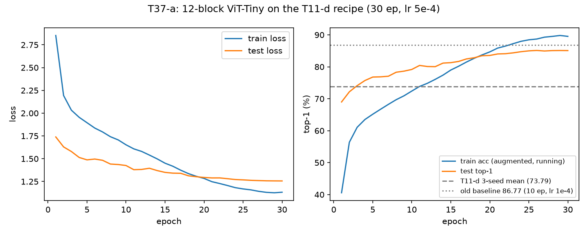

# T37 · Fair baseline: 12-block ViT-Tiny on the T11-d recipe

From: planning session 2026-11-16 (Fable review)

## Goal
Our only plain-ViT number (86.77) was trained 10 epochs at lr 1e-4, while every looped run uses 30 epochs at lr 5e-4.
Train the normal 12-block pretrained ViT-Tiny on exactly the T11-d recipe so every "looped vs baseline" comparison
uses the same rules.

## Run
T37-a = `--model baseline`, pretrained timm `vit_tiny_patch16_224`, all 12 blocks, recipe identical to T11-d
(CIFAR-100 224 px, AdamW lr 5e-4 all params, wd 0.05, 1 warmup epoch + cosine over 30 epochs, label smoothing 0.1,
batch 128, AMP, seed 0, nothing frozen). Checkpoint `T37-a_baseline_12blk_30ep.pt`.

    CUDA_VISIBLE_DEVICES=N SMOKE=1 bash tasks/T37_fair_baseline_30ep/run.sh   # 1 epoch, --subset 512
    CUDA_VISIBLE_DEVICES=N bash tasks/T37_fair_baseline_30ep/run.sh           # full run
    CUDA_VISIBLE_DEVICES=N .venv/bin/python -m tasks.T37_fair_baseline_30ep.eval_train   # train-set top-1

## Predictions (written before running)
T37-a 85.0 to 87.5 test top-1; training-set top-1 above 95.

## Results
Run 2026-11-18 on GPU 0, about 48 s per epoch (24 min). Numbers from `results/baseline_T37-a.json`,
train-set number from `results/train_set_acc.json`.

| | T37-a |
|---|---|
| Test top-1, epoch 10 | 79.17 |
| Test top-1, epoch 30 (final) | 85.08 |
| Best test top-1 | 85.12 (epoch 26) |
| Train-set top-1, epoch 30 (50k images, eval transform) | 99.68 |
| Params | 5,543,716 |
| GFLOPs per image | 2.51 |

| Model | Recipe | Params | GFLOPs | Test top-1 |
|---|---|---|---|---|
| T37-a, 12 blocks | 30 ep, lr 5e-4 (T11-d recipe) | 5.54M | 2.51 | 85.08 |
| T11-d, 2+10 | 30 ep, lr 5e-4 | 1.54M | 2.51 | 73.79 (3-seed mean; seed 0 74.11) |
| Old baseline, 12 blocks | 10 ep, lr 1e-4, different recipe | 5.54M | 2.51 | 86.77 |

On the same recipe, the gap between the 12-block model and 2+10 is 11.3 pt (85.08 - 73.79), not the 13.0 pt we got
from the old 86.77 run. The higher lr / longer schedule costs the 12-block model 1.7 pt against the gentle
10-ep, lr 1e-4 fine-tune. It also overfits more: the clean train set is at 99.68 while test loss flattens from about
epoch 24 (1.27 to 1.26). Both models cost 2.51 GFLOPs, since 2+10 still runs 12 block passes: looping saves
parameters (3.6x fewer), not compute.

## Prediction check
- T37-a 85.0 to 87.5 test top-1: right, just inside (85.08).
- Training-set top-1 above 95: right (99.68).
