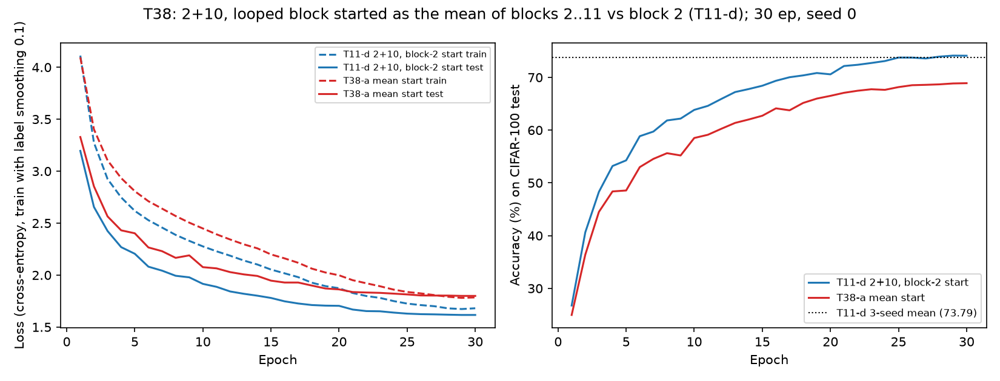

# T38 · Start the looped block as the average of blocks 3 to 12, not block 3

From: advisor meeting 2026-11-19
Notion: https://notion.so/41d38c734705810fb0a5d78ba8c4df01

## Goal
In 2+10 (T11-d: B0, B1, then one block applied 10 times) the looped block has to stand in for the ten pretrained
blocks it replaces. Today it starts as a copy of pretrained block 2 (0-based; "block 3" in 1-based counting).
Dr. Uddin's idea: start it as the element-wise average of those ten blocks (0-based 2 to 11) instead. One run,
compared with T11-d.

"Element-wise mean" means: every tensor of the looped block (attention qkv and proj weights and biases, MLP fc1/fc2
weights and biases, both LayerNorms' weight and bias) is set to the average of the same tensor over blocks 2..11.
Everything else (B0, B1, patch/position embedding, CLS token, final_norm, classifier) starts exactly as in T11-d.

## Runs
Recipe identical to T11-d: pretrained timm `vit_tiny_patch16_224`, CIFAR-100 224 px, AdamW lr 5e-4 all params,
wd 0.05, 1 warmup epoch + cosine over 30 epochs, label smoothing 0.1, batch 128, AMP, seed 0, loss at the last loop
only, nothing frozen.

| Run | Looped block starts as | Flags | Checkpoint |
|---|---|---|---|
| T11-d (reference) | pretrained block 2 | `--model unroll --unique-blocks 3` | `T11-d_unroll_n3_30ep.pt` |
| T38-a | mean of pretrained blocks 2..11 | `--model unroll --unique-blocks 3 --body-init-range 2 11` | `T38-a_2p10_meaninit_30ep.pt` |

Checkpoints in `/storage/INSLAB/Data/nrs3qy/checkpoints/itertf/`. T11-d's per-epoch history (for the comparison and
the loss-curve plot): `tasks/T11_pretrained_hbt_body_sweep/results/unroll_T11-d.json`.

    CUDA_VISIBLE_DEVICES=N SMOKE=1 bash tasks/T38_mean_init_body/run.sh T38-a   # 1 epoch, --subset 512
    CUDA_VISIBLE_DEVICES=N bash tasks/T38_mean_init_body/run.sh T38-a           # full run

New flag `--body-init-range START END` (src.train, src.models.build_unrolled): the repeated block starts as the
element-wise mean of pretrained blocks START..END (inclusive, 0-based). Default (not set) = pretrained block
`unique_blocks - 1`, exactly as before; old checkpoints rebuild unchanged. Plain unrolled layout only (not with the
T14/T16/T20/T28/T29 options). The existing `--init avg` is different: it averages all 12 blocks and only for the old
fully shared `iterative` / `lora` models. Test:
`PYTHONPATH=. .venv/bin/python -m pytest tasks/T38_mean_init_body -q` (2..2 equals block 2 exactly; 2..11 matches a
hand-computed mean within 1e-6 for `attn.qkv.weight` and `norm1.bias`; params stay 1,539,940; B0 and B1 unchanged; the
flag is saved in the checkpoint kwargs only when set). The test uses the ViT-Tiny architecture with random weights
(no download); the checks hold for any weights.

Smoke test (1 epoch, `--subset 512`, GPU 3): runs, params 1,539,940, `body_init_range: [2, 11]` in the run json.

## Decision rule (fixed in advance)
Compared with T11-d's 3-seed mean 73.79 (seed 0: 74.11):
- T38-a ≥ 74.6 (0.8 above 73.79): "mean start helps, run seeds 1 and 2 before claiming it".
- Within 0.8 of 73.79: "tie".
- Below 73.0: "mean start hurts".
Seed spread is 0.3 to 0.8 pt (T15): a one-seed difference under 0.8 pt is not an effect.

## Predictions (written before running)
T38-a 72.0 to 74.5, so a tie or slightly worse. Reason: in the old fully shared model (one block x12) an
all-12-block mean start scored 52.96 vs block 0's 58.06. Epoch-1 top-1 lower than T11-d's.

## Results
Run finished 2026-11-19 on GPU 3 (about 48 s per epoch). All numbers are CIFAR-100 test top-1 (10,000 images, 224 px),
seed 0, 30 epochs, T11-d recipe. Sources: `results/unroll_T38-a.json` and T11-d's
`tasks/T11_pretrained_hbt_body_sweep/results/unroll_T11-d.json`. `tasks/T38_mean_init_body/plot.py` prints every
number below.

| Run | Looped block starts as | Params | GFLOPs / image | Top-1 epoch 1 | Top-1 epoch 10 | Top-1 epoch 30 | Best (epoch) |
|---|---|---|---|---|---|---|---|
| T38-a | mean of pretrained blocks 2..11 | 1,539,940 | 2.51 | 24.96 | 58.51 | 68.90 | 68.90 (30) |
| T11-d (seed 0) | pretrained block 2 | 1,539,940 | 2.51 | 26.75 | 63.84 | 74.11 | 74.13 (29) |
| T11-d 3-seed mean | pretrained block 2 | | | | | 73.79 | |

T38-a vs T11-d: −1.79 pt at epoch 1, −5.33 at epoch 10, −5.21 at epoch 30 (−4.89 vs the 3-seed mean).
GFLOPs come from `src/metrics.py:count_gflops`, the same counter and device as T37. Same layout means the same FLOPs.

### Decision line (rule fixed in advance)
**"Mean start hurts."** 68.90 is below 73.0 (4.89 pt below 73.79).

### How big is this (honest sizing)
**Big.** −4.9 pt is about 6x the 0.3 to 0.8 pt seed spread (T15), so one seed is enough to call it. It is also the
same size and direction as the old fully shared model, where an all-12-block mean start scored 52.96 vs block 0's
58.06 (−5.1). A likely reason (not tested here): each block's weights only make sense together with that block's own
features, so the element-wise average of ten different blocks is a block none of them is, not a "typical" one. The gap
opens in the first 10 epochs and never closes. The 30-epoch schedule does not recover from the worse start.

**How to read this.** Left: loss per epoch. Dashed lines are the training loss (augmented images, label smoothing
0.1). Solid lines are the test loss (plain cross-entropy). Lower is better. Right: test top-1 accuracy per epoch,
dotted line at T11-d's 3-seed mean (73.79). Colours: red = T38-a (mean start), blue = T11-d (block-2 start, logged
run). What to look for: whether red catches up with blue by the end. It does not. Takeaway: the mean start is behind
from epoch 1, falls about 5 pt behind by epoch 10, and stays there. Its train loss at epoch 30 is also higher (1.79 vs
1.68), so the model fits the training data worse. That means a harder optimisation, not overfitting.

## Prediction check
- T38-a 72.0 to 74.5 ("a tie or slightly worse"): **wrong**. It scored 68.90, 3.1 pt below the bottom of the range.
  The direction was right (worse), but the size matched the old fully shared result (−5) rather than a tie.
- Epoch-1 top-1 lower than T11-d's: **right** (24.96 vs 26.75).
